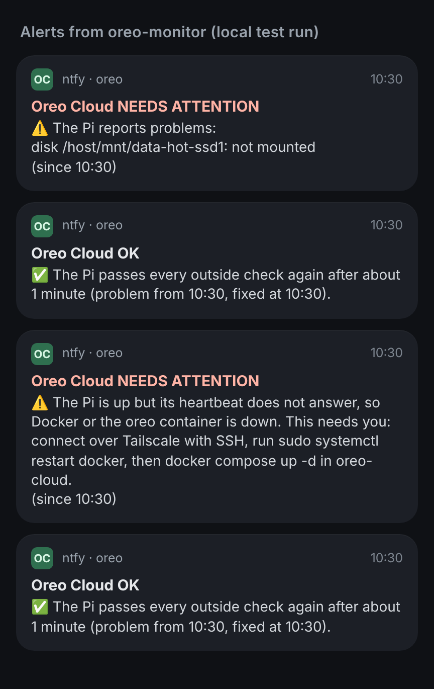

# oreo-monitor

[](LICENSE)

Checks the **oreo-cloud** Raspberry Pi from outside, once an hour, and sends an alert to my phone when it is down. The Pi's own alerts cannot do that: when the Pi, its network or Docker stops, it can no longer warn anyone.

- Runs as a GitHub Actions workflow, so it needs no other server. The repository is public, so the minutes are free.
- It holds no secrets or server details. Those are GitHub secrets.
- The Pi's own code lives in the private repository `oreo-cloud`.

## How it works

Each run joins my tailnet as a temporary device and checks, in order, stopping at the first failure:

| Step | If it fails, the alert says |
| --- | --- |
| The Pi answers on Tailscale | The Pi is off, has lost its network, or Tailscale on it stopped |
| SSH answers | The system may be hung and need a power cycle |
| The heartbeat answers | Docker or the `oreo` container is down: log in and restart Docker (this is manual on purpose) |
| The heartbeat reports all checks passing | Which checks on the Pi are failing |
| Immich answers through Caddy | The Pi is healthy but the website is not |

Alerts use the same titles as the Pi's own:

- **Oreo Cloud NEEDS ATTENTION** when a problem is seen on two runs in a row, so one missed run does not wake anyone. With hourly runs that is one to two hours after the problem starts. Sent again if the problem changes, and as a reminder on every hourly run until it is fixed.
- **Oreo Cloud OK** when the Pi is reachable again, with how long it was down.
- Nothing during the router's daily restart, 05:55 to 06:15, unless the problem outlasts it.

These are real alerts from a local test run: a drive not mounted, then Docker's heartbeat stopped, each followed by its fix.



GitHub can start scheduled runs a few minutes late. The up/down state is kept in the Actions cache, so nothing about outages is published in this public repository, and the logs name only the failing step.

## Set up

1. **Tailscale tag and access.** In the Tailscale admin console, under Access controls, then JSON editor, let a `tag:ci` device reach the Pi's SSH, heartbeat and HTTPS ports. Add to the existing file, keeping what is there:

   - this line just inside the file's outer `{` (or only the `tag:ci` entry, if a `tagOwners` block exists):

     ```json
     "tagOwners": { "tag:ci": ["autogroup:admin"] },
     ```

   - this entry inside the existing `"grants": [ … ]` list, with a comma after the entry before it:

     ```json
     { "src": ["tag:ci"], "dst": ["<pi-tailscale-ip>"], "ip": ["tcp:22", "tcp:8787", "tcp:443"] }
     ```

   If the file still has the default rule that allows everything, that rule already covers the runner; the entry above keeps it working once the default is removed.

2. **Tailscale OAuth client.** Under Settings, then Trust credentials, add a credential of type OAuth with **Auth Keys: Write** and the tag `tag:ci`. The secret is shown only once; copy it straight into step 3. A secret that does not start with `tskey-client-` shows up as `invalid key: unable to validate API key` in the run log.

3. **Repository secrets.** In this repository, under Settings, then Secrets and variables, then Actions, add:

   | Secret | Value |
   | --- | --- |
   | `TS_OAUTH_CLIENT_ID`, `TS_OAUTH_SECRET` | From step 2 |
   | `OREO_HOST` | The Pi's Tailscale address (`tailscale ip -4` on the Pi); it needs no name lookup |
   | `OREO_HEARTBEAT_TOKEN` | The same value as in the Pi's `.env` |
   | `OREO_NTFY_URL` | The ntfy topic, the same as the Pi's |
   | `OREO_NTFY_TOKEN` | Only if the topic is protected |
   | `OREO_SITE_URL` | Optional: `https://cloud.animesh.org.in/api/server/ping` |

4. **Try it.** Under Actions, open **Monitor** and choose **Run workflow**. A green run means the Pi passed every step.

GitHub turns off scheduled workflows in a public repository after 60 days without any commits. Merging Dependabot's weekly pull requests counts as activity and keeps it running.

## Development

```bash
python3 -m venv .venv && . .venv/bin/activate
pip install pre-commit pytest
pre-commit install
pytest
```

- Pre-commit hooks check formatting and YAML, check each commit message (one line, capitalised, at most 72 characters, no extra trailers), block commits to `main` and run the tests before a push. CI runs the same on every pull request, plus the pull request title; Dependabot's commits are checked by title only, since a squash merge keeps only the title.
- The `PR description` workflow tidies each pull request description: it removes co-author and session lines and any "generated by" or "requested by" footer. It never fails and never comments.
- To merge a Dependabot pull request, approve it and leave the merge button alone: the `Dependabot merge` workflow waits for the checks and squash-merges it with just its title, without the `Co-authored-by` and `Signed-off-by` lines GitHub's button would add.
- Dependabot opens weekly pull requests for the GitHub Actions, which are pinned to commit SHAs.

## Changes

Every change goes through a pull request against `main` and is squash-merged by the owner. The rules are in `CLAUDE.md`.

## License

Copyright © 2026 Animesh Singh. Released under the [MIT License](LICENSE).
